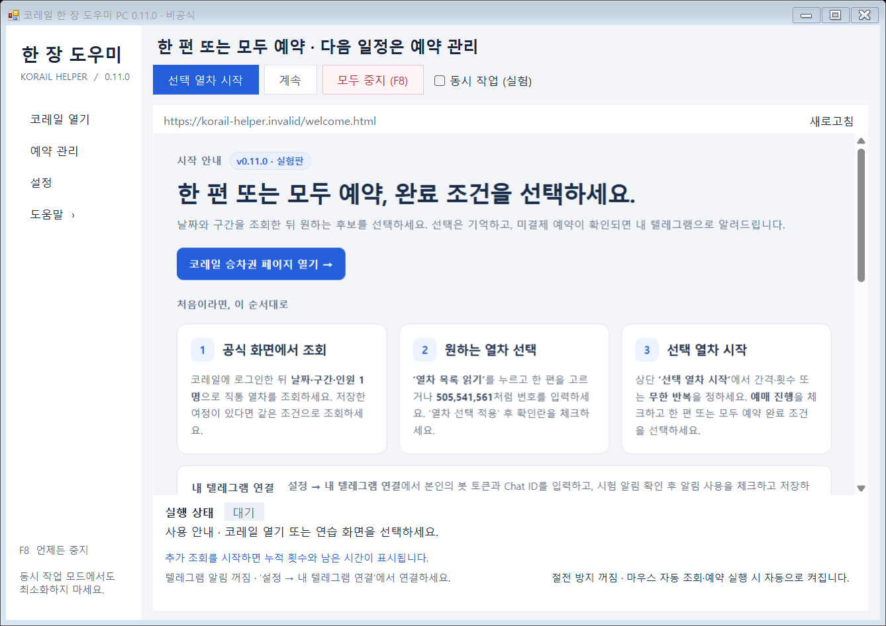
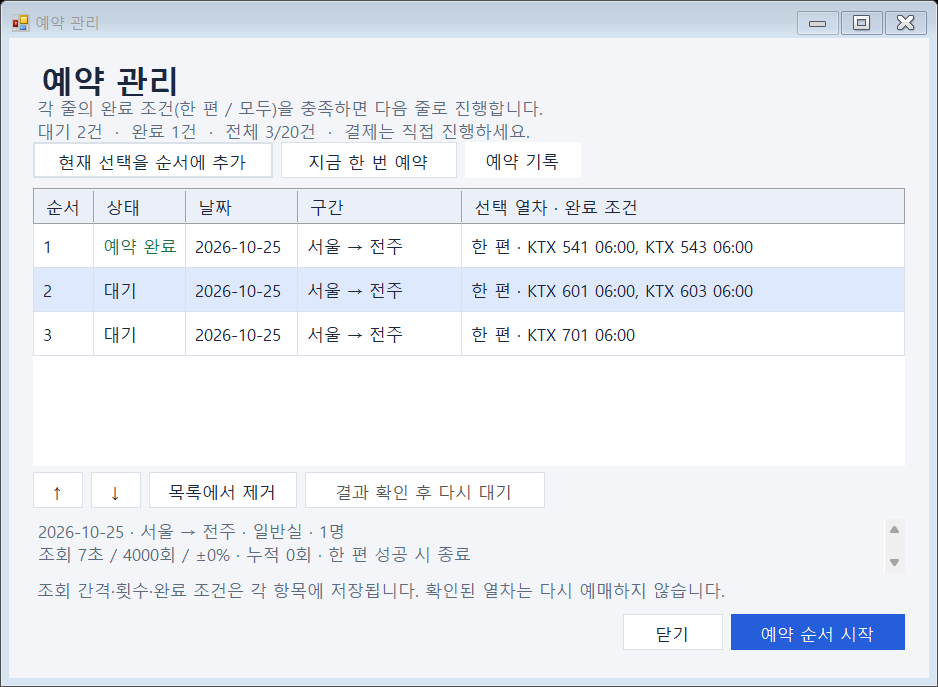
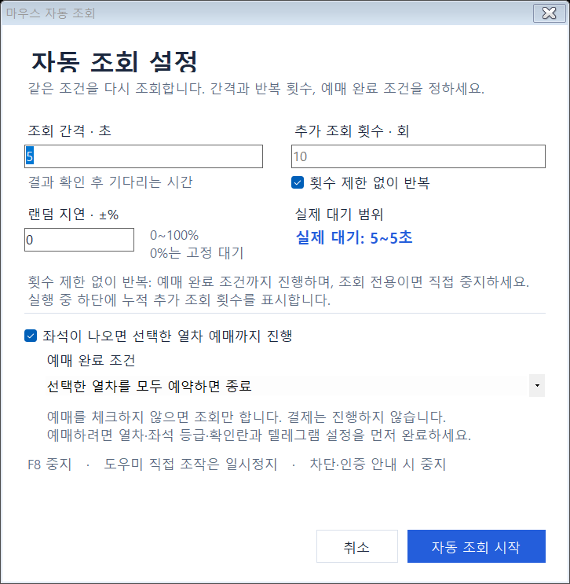

# 코레일 한 장 도우미 PC

Windows에서 공식 코레일 화면을 조작해, 선택한 열차의 미결제 예약을 진행하고 본인의 Telegram 봇으로 알리는 **비공식 개인용 프로그램**입니다. 날짜·구간·열차·좌석 등급과 Telegram 수신자는 직접 지정합니다. 여러 후보 중 **한 편만 예약**할지, 선택한 **모든 열차를 각각 예약**할지 정하고, 다음에 예약할 여정을 **예약 순서**에 미리 넣을 수 있습니다. 각 예약은 총 1명이며 결제는 자동으로 하지 않습니다.

**[안정 버전 0.9.0 다운로드](https://github.com/juhyeonmoon10/korail-one-helper/releases/tag/v0.9.0)** · **[무한 조회·모두 예약 실험판 0.11.0](https://github.com/juhyeonmoon10/korail-one-helper/releases/tag/v0.11.0)** · [자세한 사용 안내](docs/USAGE.txt) · [검증 기록](docs/VERIFICATION.txt)

안정 배포는 **0.9.0**을 유지합니다. **0.11.0은 별도 프리릴리스 실험판**이며, **횟수 제한 없이 반복**, **누적 추가 조회 시도 횟수**, **소수점 두 자리 남은 시간**, **한 편 또는 모두 예약 완료 조건**을 추가했습니다. 0.10.0의 **동시 작업 (실험)**과 이전 예약 순서 수정도 포함합니다. 새 기능의 실제 코레일 조회·예약 호환성은 **미검증**입니다.

**0.9.0에서 메뉴를 통합하고 열차 선택 저장·예약 순서를 추가했습니다.** 왼쪽 메뉴는 **코레일 열기 / 예약 관리 / 설정 / 도움말**, 상단 실행 버튼은 **선택 열차 시작 / 계속 / 모두 중지 (F8)**입니다. 설정이나 다른 페이지에 다녀와도 적용한 열차를 기억하며, 같은 조회 결과가 나타나면 다시 확인해 복원합니다.



<details><summary>예약 관리 화면 보기 · 예시 데이터</summary>



</details>

<details><summary>자동 조회 설정 화면 보기</summary>



</details>

## 1. 다운로드하고 실행하기

준비 환경은 **Windows 10/11 x64**, **.NET Framework 4.6.2 이상**, **Microsoft Edge WebView2 Runtime**입니다.

1. 위에서 안정 버전 또는 실험판을 선택하고, 해당 릴리스의 **Assets**에서 `korail-desktop.zip`을 받습니다. 이번 무한 조회·모두 예약 옵션은 **0.11.0 실험판**에 있습니다.
2. ZIP을 폴더에 **모두 압축 해제**합니다.
3. 기존 도우미가 실행 중이면 닫고, 압축을 푼 폴더의 `KorailOneHelper.exe`를 실행합니다.
4. 처음 실행하면 **처음 시작 · 내 텔레그램 연결** 설정창이 열립니다.

실제 예약 알림에는 본인의 Telegram 연결이 필요합니다. **나중에**를 누르면 저장하지 않고 시작하며, 조회만 사용하거나 모의 연습을 할 수 있습니다. 설정은 왼쪽 **설정 → 내 텔레그램 연결**에서 다시 엽니다. 텔레그램 연결만 변경하면 현재 코레일 페이지를 다시 불러오지 않습니다.

## 2. 내 Telegram 봇 연결하기

1. Telegram에서 공식 **BotFather**를 열고 `/newbot`을 보냅니다.
2. 안내에 따라 봇을 만들고 발급된 **봇 토큰**을 준비합니다.
3. 방금 만든 **본인 봇의 대화**를 열고 `/start`를 보냅니다.
4. EXE 설정창의 **내 봇 토큰**에 토큰을 입력합니다.
5. **Chat ID 찾기**에서 본인의 대화를 선택하거나 **내 Chat ID**를 직접 입력합니다. 그룹 Chat ID는 직접 입력합니다.
6. **테스트 알림 보내기**를 눌러 본인의 Telegram 대화에서 수신을 확인합니다.
7. **예약 완료가 확인되면 텔레그램 알림 보내기**를 체크하고 **저장**합니다.

**테스트 알림 성공만으로 설정이 저장되거나 알림이 켜지지는 않습니다.** 저장한 연결이 있으면 다음 실행에서는 첫 설정창을 건너뜁니다. 공용 봇이나 기본 수신자는 없으며 각 사용자가 자신의 봇을 연결합니다.

## 다른 앱과 동시에 사용하기 · 0.10.0부터 실험 기능

실행 전에 상단 **동시 작업 (실험)**을 체크한 뒤 **선택 열차 시작** 또는 **예약 순서 시작**을 누르세요. 열차 목록을 펼칠 때도 먼저 체크하고 **열차 목록 읽기**를 누르면 적용됩니다. 체크는 **앱을 켤 때마다 꺼진 상태**이며 저장되지 않습니다. 실행 중에 변경하면 현재 동작을 중지하므로 다시 시작해야 합니다.

이 모드는 도우미의 **WebView 화면에만 입력**합니다. 다른 앱을 클릭하거나 키보드로 입력하고 **Alt+Tab**으로 전환해도 조회·더보기·예약과 다음 여정의 날짜·구간 입력을 이어갑니다. Windows 마우스 포인터를 이동시키거나 다른 앱에 키를 보내지 않습니다. **도우미 안을 직접 클릭·스크롤·입력하면 기존 규칙대로 일시정지하거나 중지**하며, **F8**은 다른 앱을 사용하는 중에도 중지합니다.

**최소화·화면 잠금·절전 상태에서의 계속 실행은 지원하지 않습니다.** 도우미 창을 열어 두세요. 다른 창이 도우미를 완전히 가리면 WebView 동작이 지연되거나 멈출 수 있으므로 **화면 일부를 보이게 두는 것을 권장**합니다. 알려진 정차 안내만 자동으로 처리하며, 다른 안내가 나오면 중지하고 상단 **안내 확인**에 표시합니다. 실제 코레일 호환성을 확인한 기능으로 간주하지 마세요.

## 3. 원하는 날짜와 열차 선택하기

1. **코레일 열기**를 누르고 도우미 안의 공식 코레일 화면에서 직접 로그인합니다.
2. 원하는 날짜·출발역·도착역으로 **직통·총 1명**을 직접 조회합니다.
3. 도우미에서 **일반실 또는 특실** 등급을 선택합니다.
4. **열차 목록 읽기**를 누릅니다. 기본 마우스 모드는 도우미 창을 앞에 두고, 동시 작업 모드는 창 일부가 보이도록 둡니다. **더보기**가 있으면 선택한 입력 방식으로 스크롤하고 눌러 목록 끝까지 읽습니다. 완료되면 선택 패널이 다시 펼쳐집니다.
5. 한 편만 고르려면 드롭다운에서 열차를 선택합니다. 여러 편이면 **여러 열차번호 (선택)**에 `505,541,561`처럼 쉼표로 구분해 입력합니다. 이 칸이 비어 있으면 드롭다운의 한 편을 사용합니다.
6. **열차 선택 적용**을 누르고 날짜·구간·시각·열차·등급을 확인한 뒤 여정 확인란을 체크합니다.

여러 열차는 **같은 날짜·구간·등급·총 1명** 조건에서 최대 **20편**까지 지정합니다. 모든 번호가 펼친 조회 결과에 있어야 합니다. 입력한 번호 순서대로 확인하며, 가격이 표시된 첫 후보를 고릅니다. 가격 선택부터 해당 예약의 완료 확인까지는 그 한 편으로 고정합니다. 이후 다른 선택 열차를 예약할지는 아래 **예매 완료 조건**에 따릅니다.

**0.8.3부터 더보기 아래 열차도 선택할 수 있습니다.** 번호를 적용했을 때 찾지 못한다면 먼저 **열차 목록 읽기**로 목록을 펼치세요. 한 번의 목록 펼치기에는 더보기 최대 **30회**, 결과 최대 **2,000행** 제한이 있습니다. 읽을 수 없는 결과에서는 중지하며, 다른 날짜의 조회 버튼은 누르지 않습니다.

**적용한 열차는 PC에 저장됩니다.** 다른 페이지에서는 저장한 날짜·구간·후보 목록을 표시하며, 같은 조회 조건과 정확히 같은 열차·시각·등급이 다시 나타나면 복원합니다. 이전에 확인란을 체크했더라도 현재 조회 조건이나 열차가 다르면 확인된 선택으로 사용하지 않습니다. 더보기 아래 후보가 빠졌다면 **열차 목록 읽기**로 다시 펼치세요. 저장 선택을 없애려면 **선택 초기화**를 누릅니다. 복원만으로 실행을 시작하지 않습니다.

새 여정을 선택할 때는 공식 화면에서 직접 조회합니다. **설정의 여정 필터**를 켰다면 그 조건과 맞는 후보를 선택해야 합니다. 예약 순서에 추가한 항목은 추가 당시 조건을 따로 보관하므로, 이후 다른 여정을 선택하거나 필터를 바꿔도 이미 추가한 항목은 바뀌지 않습니다. Chrome의 로그인 상태는 도우미에 그대로 적용되지 않습니다. 환승·왕복·인접역 묶음 조회는 지원하지 않습니다.

## 4. 바로 예약하거나 매진 열차 재조회하기

| 상황 | 실행 방법 |
| --- | --- |
| 선택한 후보 중 가격이 표시된 열차를 한 번 예약 | **예약 관리 → 지금 한 번 예약**을 누릅니다. |
| 매진 열차를 기다리며 예약까지 진행 | **선택 열차 시작**에서 간격·랜덤 지연·횟수 또는 무한 반복을 정하고 **좌석이 나오면 선택한 열차 예매까지 진행**을 체크한 뒤 **예매 완료 조건**을 선택합니다. |
| 조회만 반복 | **선택 열차 시작**에서 예약 진행 체크를 해제한 채 시작합니다. 기본값입니다. |

조회 간격과 횟수 제한을 사용할 때의 추가 조회 횟수는 각각 **1~2,147,483,647의 정수**입니다. `5`초와 `999999`회 또는 `9999999`회도 그대로 적용됩니다. 빈칸·소수·음수·범위 밖 값은 오류를 표시하고 시작을 막으며, 다른 값으로 몰래 보정하지 않습니다. 별도 총 실행시간 제한은 없습니다.

**횟수 제한 없이 반복**을 체크하면 횟수 입력칸이 비활성화됩니다. 예매 진행을 켰다면 아래의 완료 조건을 만족할 때까지 반복하며, **조회만** 선택했다면 직접 **F8 또는 모두 중지**로 끝냅니다. 무한 반복에서도 차단·인증 안내, 확인할 수 없는 결과와 오류에서는 중지하며 기존 확인 기한을 유지합니다.

실행 중 하단에 **누적 추가 조회 시도 N회**가 표시됩니다. 처음 직접 조회한 횟수와 더보기 클릭은 제외합니다. 입력 전달에 실패한 시도도 포함될 수 있으므로 성공한 조회 결과 수를 뜻하지 않습니다. 일시정지·예약 진행 중에도 마지막 횟수를 표시합니다. 다음 재조회까지의 시간은 **4.37초**처럼 소수점 두 자리로 표시합니다.

예매 진행을 켜면 **예매 완료 조건**에서 다음 중 하나를 고릅니다.

- **선택한 열차 중 하나라도 예약되면 종료**: 기본값입니다. 한 편의 미결제 예약이 확인되면 나머지 후보를 예약하지 않습니다.
- **선택한 열차를 모두 예약하면 종료**: 각 열차를 **총 1명씩, 한 건씩** 예약합니다. 한 편의 완료 확인과 Telegram 알림 처리를 마치면 같은 여정을 다시 조회해 남은 열차를 진행합니다. 각 예약을 확인할 때마다 알립니다. 이미 완료한 열차는 다시 예약하지 않습니다.

**모두 예약**을 **선택 열차 시작**에서 바로 실행하면 해당 작업이 예약 관리에 추가되며, 그 작업만 실행합니다. 기존에 대기 중이던 다른 여정은 함께 시작하지 않습니다. 횟수 제한을 정했다면 그 횟수는 **해당 항목 전체의 추가 조회 예산**입니다. 중간에 한 편을 예약해도 횟수를 초기화하지 않으며, 별도로 저장한 다음 여정은 자기 항목의 횟수를 사용합니다.

**랜덤 지연 (±%)**은 **0~100%**로 설정합니다. 기본값 **0%**는 입력한 간격 그대로 기다립니다. 예를 들어 간격 5초·랜덤 지연 0%면 **5초**, 20%면 매번 **4~6초** 중에서 정합니다. 범위는 `간격 × (1 ± 비율)`이며, 0초 대기를 막기 위해 실제 대기는 **최소 1초**로 제한합니다. 300초 상한은 없습니다.

첫 재조회 전과 이전 요청의 **결과 확인이 끝난 뒤** 다음 재조회 전에 각각 한 번만 정합니다. 따라서 5초 설정은 결과 확인 후 5초 대기이며, 조회 버튼을 정확히 5초마다 누른다는 뜻은 아닙니다. 요청 처리 중에는 다음 조회를 겹쳐 보내지 않습니다. 기다리는 동안 다시 뽑지 않으며, 하단에 남은 시간을 표시합니다. 랜덤 지연이 자동화 감지나 이용 제한을 막아 준다는 보장은 없습니다.

예약 흐름은 가격 클릭 → 인식 가능한 안내 확인 → 예매 1회 → 미결제 예약 확인 → Telegram 알림 순서입니다. 예매 버튼을 누른 사실만으로 완료 알림을 보내지 않습니다. 선택 여정과 일치하는 예약을 확인해야 전송합니다.

예약을 포함한 재조회 후 아직 예약하지 않은 후보가 첫 목록에 없으면 **남은 후보를 찾을 때까지 더보기**를 누릅니다. 처음 선택한 후보의 순서를 유지하며, 먼저 보이는 다른 열차로 바꾸지 않습니다. 더보기 클릭은 **추가 조회 시도 횟수와 별도로** 셉니다. **조회만** 모드는 기존처럼 조회만 반복합니다.

알림은 **미결제 예약 확인**입니다. 예약을 유지하려면 공식 코레일 화면에 표시된 결제기한까지 직접 결제해야 합니다. 기한이 지나면 예약이 자동 취소될 수 있습니다.

## 5. 첫 예약이 끝나면 다음 여정 예약하기

1. 공식 코레일 화면에서 첫 여정의 열차를 선택·적용하고 확인란을 체크합니다.
2. **예약 관리 → 현재 선택을 순서에 추가**를 누릅니다.
3. 이 항목의 조회 간격·랜덤 지연·횟수 또는 무한 반복과 **예매 완료 조건**을 정하고 **예약 순서에 추가**를 누릅니다.
4. 관리창을 닫고 다음 날짜·구간을 직접 조회한 뒤, 원하는 후보를 선택해 같은 방법으로 추가합니다.
5. **예약 관리**에서 순서를 확인합니다. 대기 항목은 위·아래로 옮기거나 목록에서 제거할 수 있습니다.
6. 날짜 선택창이 충분히 보이도록 도우미 창을 넓힌 뒤 **예약 순서 시작**을 누릅니다. 기본 마우스 모드는 창을 앞에 두고, 다른 앱을 함께 쓰려면 시작 전에 **동시 작업 (실험)**을 체크합니다.

**한 줄이 예약 작업 한 항목**입니다. 순서는 최대 **20항목**, 각 항목은 같은 여정의 열차 최대 **20편**을 보관합니다. 항목마다 완료 조건을 저장합니다. 예를 들어 첫 줄의 `505,541`을 **모두 예약**, 둘째 줄의 다른 날짜 `506,542`를 **하나라도 예약**으로 설정하면 첫 줄의 두 편을 각각 예약한 뒤 둘째 줄에서 한 편을 예약합니다. 기본 완료 조건은 기존과 같이 **하나라도 예약**입니다.

각 예약은 **실제 미결제 예약 확인 → Telegram 알림 처리** 순서로 진행합니다. 모두 예약에서 남은 열차가 있으면 해당 항목을 다시 조회하고, 항목의 완료 조건을 만족해야 다음 여정으로 이동합니다. 다음 날짜·구간은 공식 코레일의 역·날짜 선택창과 조회 버튼을 선택한 입력 방식으로 조작해 입력합니다. 동시 작업 모드는 이 새 여정 조회에도 적용됩니다. 공식 날짜 선택창에서 가능한 범위에 맞춰 조회 시작 시각을 조정할 수 있지만, 남은 열차 중 가장 이른 출발 시각을 넘기지 않으며 **예약할 열차의 날짜·구간·시각·등급은 바꾸지 않습니다.**

예약 완료가 확인된 뒤 알림 전송만 실패하면 예약을 다시 요청하지 않습니다. 확인된 예약 기록을 유지하고 남은 열차 또는 다음 항목으로 진행하며, 전송 결과는 상태줄과 본인 Telegram 대화에서 확인합니다. 예약 결과가 불명확하거나 중간에 중지되면 **결과 확인** 상태로 남고 다음 예약을 시작하지 않습니다. 공식 예약 내역을 확인한 뒤 관리창의 **예약 기록** 또는 **결과 확인 후 다시 대기**를 사용하세요. 이미 완료한 열차의 중복 방지 기록은 유지합니다.

앱을 다시 켜도 순서와 선택은 남지만 **자동으로 시작하지 않습니다.** 중단된 진행 항목은 먼저 결과 확인이 필요합니다. **목록에서 제거**는 프로그램의 순서 목록만 정리하며 실제 예약을 취소하지 않습니다. 기본 마우스 모드에서는 다음 조회 조건 입력이나 알림 처리 중 직접 입력·창 전환이 있으면 순서를 중지합니다. 동시 작업 모드는 다른 앱의 조작을 허용하지만 도우미를 직접 조작하면 중지합니다. **F8·모두 중지·최소화**는 다음 항목 진행까지 중단합니다.

## 실행 중 지켜야 할 조건

- 기본 마우스 모드는 도우미 창을 앞에 둡니다. **마우스를 움직이기만 해도 실행은 계속됩니다.** 동시 작업 모드는 다른 앱에서 클릭·입력·Alt+Tab 전환을 해도 계속합니다.
- **가격 선택 전의 대기·조회·더보기 단계**에서 기본 모드는 클릭·스크롤·키 입력이나 창 전환 시, 동시 작업 모드는 도우미를 직접 조작할 때 **일시정지**합니다. 자동으로 재개하지 않습니다. 창을 복원하고 **계속**을 누르면 기존 화면 조건을 다시 확인한 뒤 진행합니다. 두 모드 모두 단독 실행의 최소화는 일시정지하며, **예약 순서 실행의 최소화는 전체 순서를 중지**합니다.
- 일시정지해도 선택한 열차·조회 횟수·다음 조회 예정 시각은 유지합니다. 가격 선택 뒤나 예매 요청 뒤에 위 조작을 하면 기존처럼 중지합니다. 예매 요청이 있었다면 공식 예약 내역에서 결과를 확인하세요.
- **F8**, **모두 중지 (F8)**, 차단·인증 안내, 사용자의 페이지 이동, 설정 변경, 화면 잠금·절전은 **완전 중지**합니다. 알 수 없는 안내나 오류에서도 중지합니다. 예약 순서가 다음 항목을 위해 진행하는 공식 페이지 이동은 해당 항목의 조건을 다시 확인한 뒤 이어집니다.
- 간격과 유한 추가 조회 횟수는 각각 **1~2,147,483,647의 정수**로 지정합니다. **횟수 제한 없이 반복**도 선택할 수 있으며, 기본값은 60초·랜덤 지연 0%·10회·조회만입니다. 무한 반복은 오류나 차단을 무시하는 옵션이 아닙니다.
- 이미 조회 또는 더보기 버튼을 눌렀다면 그때부터 **30초 안에 결과 갱신**을 확인해야 합니다. 일시정지로 이 기한이 늘어나지 않으며, 초과하면 추가 클릭 없이 중지합니다.
- 더보기 후에는 기존 열차가 같은 순서로 남고 새 행이 추가된 상태가 **1초간 안정적으로 유지**되는지 확인합니다. 결과 교체·중복·차단이나 30초간 변화가 없으면 중지합니다.
- 재조회는 매번 정한 대기 시간이 지난 뒤 수행합니다. 예약 옵션에서는 **남은 모든 후보의 선택 등급이 명확한 매진**일 때만 재조회합니다. 더보기 끝까지 확인해도 후보가 없거나 상태를 읽지 못하면 중지합니다. 가격 선택부터 해당 예약의 완료 확인까지 재조회를 해제하며, 모두 예약은 완료 확인과 알림 처리 후 남은 열차를 다시 조회합니다.
- 조건을 바꾸려면 먼저 중지하고 새 조회 결과에서 열차를 다시 선택합니다.

**일시정지와 중지는 프로그램 동작을 멈추는 기능이며, 실제 코레일 예약을 취소하지 않습니다.**

사이트 구조나 접근 제한으로 작동하지 않을 수 있습니다. 한 장 예약이나 마우스 입력 방식이 이용 제한을 받지 않는다는 보장은 없습니다.

## 절전 방지와 화면 잠금

자동 조회·예약·완료 확인 실행 중에만 **유휴 절전과 화면 꺼짐을 방지**합니다. 두 입력 모드 모두 기능 시작 시 자동으로 켜지고 하단에 상태가 표시됩니다. **일시정지 중에는 해제**하며, 계속 진행할 때 다시 켭니다. 완료·완전 중지·오류·앱 종료 시에도 해제합니다.

Windows 전원 설정을 바꾸지는 않습니다. **직접 절전 실행, 노트북 덮개 닫기, 화면 잠금과 화면보호기는 막지 못합니다.**

## 문제가 생겼을 때

| 증상 | 확인할 내용 |
| --- | --- |
| EXE가 실행되지 않음 | 압축을 모두 풀었는지, x64 Windows와 필요한 런타임이 있는지 확인합니다. 이 EXE는 코드 서명되지 않았으며 Windows 정책이 실행을 제한할 수 있습니다. 표시된 오류와 버전을 기록하세요. |
| Chat ID 찾기에 대화가 없음 | 토큰에 해당하는 본인 봇에 `/start`를 보낸 뒤 다시 찾습니다. |
| 시험 알림은 오지만 예약 알림 설정이 안 됨 | 알림 사용 체크와 **저장**까지 완료했는지 확인합니다. |
| 입력이나 창 전환으로 일시정지됨 | 기본 마우스 모드는 도우미를 앞에 둔 뒤 **계속**을 누릅니다. 다른 앱을 함께 쓰려면 중지한 뒤 **동시 작업 (실험)**을 체크하고 다시 시작합니다. 화면 조건이 바뀌었거나 기한이 지나면 재개하지 않습니다. |
| 동시 작업 중 결과가 갱신되지 않음 | 창을 최소화하지 말고 일부가 보이게 둡니다. WebView가 완전히 가려지면 정체될 수 있으며, 실제 코레일 호환성도 미검증입니다. 중지됐다면 예약 결과부터 확인합니다. |
| 동시 작업 중 안내 확인 버튼이 표시됨 | 자동 진행이 중지된 상태입니다. **안내 확인**을 눌러 내용을 직접 확인합니다. |
| 간격·횟수 입력 후 시작할 수 없음 | 간격과 유한 횟수 칸에 **1~2,147,483,647의 정수**를 입력합니다. **횟수 제한 없이 반복**을 켜면 횟수 칸은 사용하지 않습니다. 잘못된 값은 자동 보정하지 않습니다. |
| 더보기 아래 열차가 목록에 없음 | **열차 목록 읽기**로 펼친 뒤 번호를 다시 적용합니다. 기본 마우스 모드는 도우미를 앞에 두고, 동시 작업 모드는 일부가 보이게 둡니다. |
| 다른 페이지에서 저장한 선택만 표시됨 | 원래 날짜·구간·조회 조건으로 돌아가면 실제 열차를 다시 확인해 복원합니다. 후보가 더보기 아래에 있으면 목록을 펼치세요. |
| 예약 순서의 다음 항목이 시작되지 않음 | **예약 관리**의 ‘결과 확인’ 항목과 상태줄을 확인합니다. 공식 예약 내역을 확인하기 전에 같은 예약을 다시 시도하지 않습니다. |
| 다음 날짜의 시간 이동 버튼이 보이지 않음 | 도우미 창을 최대화하거나 넓힙니다. 공식 예약 내역을 확인한 뒤 **예약 관리 → 결과 확인 후 다시 대기**로 재시작합니다. 0.9.1 소스부터 이 상황의 확대 안내를 표시합니다. |
| 가격 선택 또는 예매 요청 뒤 중지됨 | 자동으로 이어서 실행하지 않습니다. 예매 요청이 있었다면 아래 예약 결과 확인을 먼저 진행합니다. |
| 코레일 차단·인증·알 수 없는 안내가 표시됨 | 자동 실행을 중지하고 공식 화면의 안내를 확인합니다. |
| 예약 결과가 불명확하거나 알림이 없음 | 추가 예매 전에 공식 코레일 **예약 내역**에서 실제 결과를 확인합니다. |

기존 예약이 있다면 상세 화면을 열고 필요한 안내를 직접 확인한 뒤, **예약 관리 → 예약 기록 → 해당 시도 선택 → 현재 화면에서 완료 확인**을 사용할 수 있습니다. 이 기능은 기존 시도의 화면만 읽으며 추가 예매를 하지 않습니다.

한 번 제출한 여정은 결과 불명이나 알림 오류가 있어도 자동으로 다시 예매하지 않습니다. **중복 방지 해제는 실제 예약 취소가 아닙니다.** 공식 예약 내역에 해당 예약이 없음을 확인한 뒤에만 사용하세요.

**도움말 → 마우스 연습**은 실제 예약·Telegram 전송 없이 흐름을 확인하는 기능입니다. 진단 저장도 도움말에 모았습니다. 수동 진단 방법은 [사용 안내](docs/USAGE.txt)에 있습니다.

## 검증 범위

**0.11.0은 JavaScript 193개·C# 800개·최종 EXE의 WebView 및 호스트 검사 270개를 통과했습니다.** 무한 조회의 큰 누적 횟수·일시정지·응답 기한, 소수점 시간 표시, Any/All 완료 기록·남은 후보·중복 방지·다른 대기 작업 보존을 검사했습니다. 설정창과 기본·최소 크기 화면도 확인했습니다. **실제 코레일의 무한 조회·모두 예약·연속 예약, Telegram 수신과 밤샘 실행은 미검증**입니다. 상세 범위는 [검증 기록](docs/VERIFICATION.txt)에 있습니다.

이전 **0.10.0은 C# 750개·최종 EXE의 WebView 및 호스트 검사 247개를 통과했습니다.** 실제 로컬 WebView에서 클릭·한글 입력·스크롤을 실행하고 Windows 커서와 활성 창이 바뀌지 않는 것을 확인했습니다. 기본·최소 창 크기와 안내 버튼 표시도 확인했습니다. **실제 코레일의 동시 작업 조회·예약·연속 예약, Telegram 수신과 밤샘 실행은 미검증**입니다. 상세 범위는 [검증 기록](docs/VERIFICATION.txt)에 있습니다.

이전 **0.9.1 소스**는 JavaScript **193개** 검사를 통과했고 EXE 컴파일을 완료했습니다. 당시 새 EXE의 실행은 Windows 애플리케이션 제어 정책에 차단됐으며, C# 전체 검사도 실행 오류로 완료하지 못했습니다. 추가한 예약 순서 재개 회귀 검사도 당시 **미실행**이었습니다. 도우미 프로세스는 실행됐지만 화면 조작 도구가 창을 찾지 못해, 당시 실제 코레일 연속 예약·Telegram 수신·연속 녹화는 **시작하지 못했습니다**. 아래 0.9.0 결과는 0.9.1 실행 검증이 아닙니다.

안정 버전 **0.9.0**은 메뉴 통합, 선택 저장·복원과 예약 순서를 추가한 버전입니다. **JavaScript 191개·C# 582개·배포 EXE의 WebView·호스트 모의 검사 207개**를 통과했습니다. 화면 판정·저장·순서 상태 전환과 기본·최소 창 크기를 확인했으며, 상세 결과는 [검증 기록](docs/VERIFICATION.txt)에 있습니다. **0.9.0의 실제 코레일 조회·연속 예약과 Telegram 수신, 밤샘 실행은 검증하지 않았습니다.**

이전 **0.8.5**는 메뉴·설정·상태 표시·열차 선택 UI를 개선한 버전입니다. **JavaScript 150개·C# 447개·배포 EXE의 WebView 모의 검사 188개**를 통과했고, 기본·최소 창 크기의 배치와 설정창·로컬 연습 화면을 확인했습니다. **이 버전의 실제 코레일 조회·예약과 Telegram 수신은 다시 검증하지 않았습니다.** 상세 검사 결과는 [검증 기록](docs/VERIFICATION.txt)에 있습니다.

이전 **0.8.4**는 조회 간격·횟수의 숨은 보정과 10분 총 실행 제한을 제거한 버전입니다. **C# 검사 447개와 배포 EXE의 WebView 모의 검사 186개**를 통과했습니다. 설정창의 5초·큰 횟수 입력, 모의 횟수·경과 시간에서의 대기 유지, 정수 경계와 요청 확인 기한을 검사했습니다. **이 버전의 실제 코레일 더보기 클릭·조회·예약과 Telegram 예약 완료 알림, 밤샘 실행은 검증하지 않았습니다.** 상세 범위는 [검증 기록](docs/VERIFICATION.txt)에 있습니다.

이전 **0.8.3**은 **열차 목록 읽기와 재조회 후 후보 탐색에 마우스 더보기**를 추가한 버전입니다. **JavaScript 150개, C# 380개, 배포 EXE의 WebView 모의 검사 159개**를 통과했습니다. 코레일의 공개 화면 코드에서 더보기 요소의 구조를 확인했지만, **이 버전의 실제 코레일 더보기 클릭·조회·예약과 Telegram 예약 완료 알림은 검증하지 않았습니다.** 상세 검사 범위는 [검증 기록](docs/VERIFICATION.txt)에 있습니다.

이전 **0.8.2**는 가격 선택 전 사용자 조작 시 일시정지하고 **계속**으로 재검증하는 기능을 추가한 버전입니다. **C# 검사 380개**, 배포 EXE의 **내장 WebView 모의 검사 120개**를 통과했습니다. 입력 분류와 재개 전 화면 검증은 로컬 검사이며 실제 마우스 후크·계속 버튼 입력의 전체 흐름 검사는 아닙니다. **0.8.2의 실제 코레일 조회·예약과 Telegram 예약 완료 알림은 검증하지 않았습니다.** 실제 절전·밤샘 동작도 검증하지 않았습니다.

이전 **0.8.1**은 랜덤 대기 정책 48개를 포함한 **C# 검사 337개**, 배포 EXE의 내장 WebView 모의 검사 **80개**를 통과했습니다.

이전 **0.8.0**은 JavaScript **125개**, C# **289개**, 배포 EXE의 내장 WebView 모의 검사 **72개**를 통과했습니다. 여러 후보의 우선순위, 매진·누락·중복·차단 상태와 후보 변경을 로컬에서 확인한 결과이며 실제 예약을 다시 시험한 것은 아닙니다.

이전 **0.7.5**에서는 열차 선택과 시작 버튼 클릭 뒤 수동 개입 없이 **실제 미결제 예약 → Telegram 수신 1건**을 확인했습니다. 결제는 하지 않았습니다. 모든 열차·안내·상황에서의 성공을 뜻하지 않으며, 버전별 결과와 상세 이력은 [검증 기록](docs/VERIFICATION.txt)에 정리했습니다.

## 개인 데이터와 GitHub 공유

설정·열차 선택·예약 순서·로그인 프로필·예약 기록은 기본적으로 `%LOCALAPPDATA%\KorailOneHelper`에 저장됩니다. 다른 폴더의 EXE도 같은 Windows 계정에서는 기존 설정을 불러옵니다. 봇 토큰은 현재 Windows 계정의 DPAPI로 암호화해 저장합니다.

**이 데이터 폴더, 봇 토큰·Chat ID, 로그인 세션, 실제 예약 기록을 GitHub나 이슈에 올리지 마세요.** 별도 `--data-dir`을 사용했다면 해당 폴더도 제외합니다. 진단 파일·화면·영상을 공유할 때는 이름·좌석·연결 정보가 포함됐는지 먼저 확인하세요. 예약 기록 파일을 임의로 삭제해 중복 방지를 초기화하지 마세요.

## 개발: 빌드·검사·포장

아래 명령은 공개 소스 루트의 Windows PowerShell에서 실행합니다. .NET Framework C# 컴파일러가 필요하며 JavaScript 검사는 Node.js 18 이상을 사용합니다. WebView2 SDK는 다운로드 스크립트로 준비합니다.

```powershell
.\download-dependencies.ps1
.\build.ps1
```

기본 출력은 `dist\KorailOneHelper.exe`입니다.

```powershell
# C# 검사: 실제 코레일·Telegram 요청 없이 실행
# 절전 검사는 짧은 Windows 유지 요청 설정/해제를 포함
.\run-mock-tests.ps1

# JavaScript 화면 판정 검사
npm install --ignore-scripts
npm test
```

검증한 EXE를 다시 빌드하지 않고 안내·체크섬과 함께 포장하려면:

```powershell
.\package-release.ps1 -ExistingExe .\dist\KorailOneHelper.exe
```

`-ExistingExe`를 생략하면 새로 빌드합니다. 포장된 EXE의 SHA-256이 검증한 파일과 같은지 확인하세요. `sign-release.ps1`은 보유한 유효한 코드 서명 인증서와 Microsoft SignTool을 사용하는 선택적 도구입니다.

## 라이선스

프로그램 소스는 [MIT License](LICENSE)로 공개합니다. 함께 사용하는 Microsoft WebView2 구성요소는 [별도 라이선스](WebView2-LICENSE.txt)를 따릅니다.
